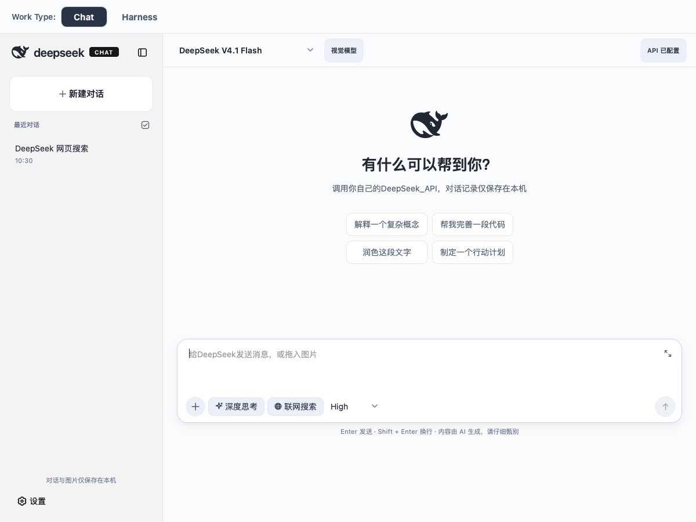
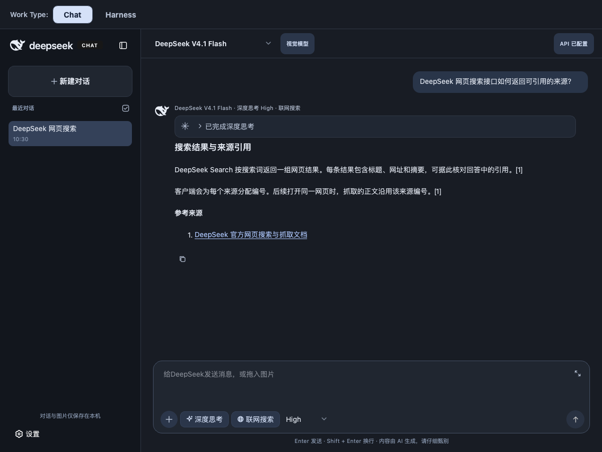
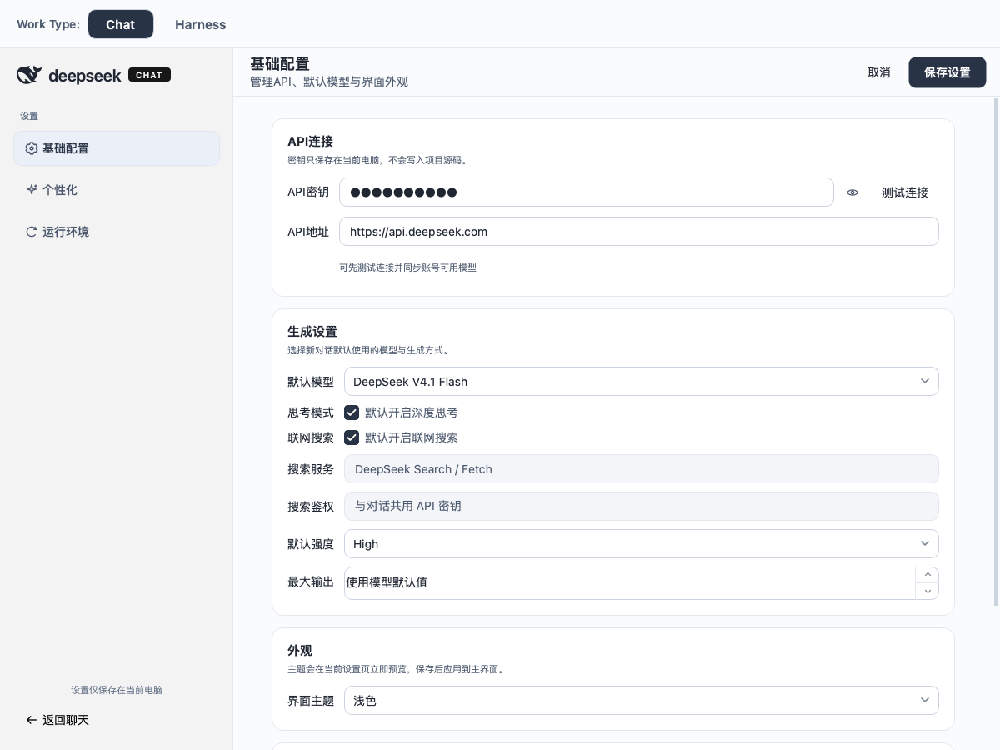

# DeepSeek 桌面客户端

面向 macOS Apple Silicon 的 DeepSeek API 客户端。顶部 **Work Type** 在原生 Chat 与官方 Harness 之间切换。对话、图片和个性化设置保存在本机。

[下载 DeepSeek 1.1.0 · macOS arm64](https://github.com/quzhenghao/deepseek-chat-gui/releases/download/v1.1.0/DeepSeek-1.1.0-macos-arm64.dmg) · [GitHub Release](https://github.com/quzhenghao/deepseek-chat-gui/releases/tag/v1.1.0)



## 安装

1. 打开 DMG，将 **DeepSeek.app** 拖入“应用程序”。安装包适用于 macOS 14.4 及以上的 Apple Silicon Mac。
2. 首次启动进入设置，填写 DeepSeek API 密钥，点击“测试连接”，确认模型列表后保存。
3. 在 Chat 选择模型与思考强度。在顶部选择 **Harness** 可进入项目工作区。

安装包使用本地 ad-hoc 签名。若 macOS 拦截启动，请确认 DMG 来自本项目的 GitHub Release，在 Finder 尝试打开应用一次，再到“系统设置 → 隐私与安全性”选择“仍要打开”。 [Apple 支持](https://support.apple.com/zh-cn/102445)

## 模型与思考

| 模型 | API ID | 输入 | 上下文 | 最大输出 |
| --- | --- | --- | ---: | ---: |
| DeepSeek V4.1 Flash 1017 | `deepseek-flash` | 文本、图片 | 1,048,576 tokens | 393,216 tokens |
| DeepSeek V4 Pro 0813 | `deepseek-v4-pro` | 文本 | 1,048,576 tokens | 393,216 tokens |

| 界面强度 | `reasoning_effort` |
| --- | --- |
| Low | `low` |
| High（默认） | `high` |
| Max | `max` |

Chat 默认连接 `https://api.deepseek.com`。测试连接通过 `/models` 同步模型，对话通过 `/chat/completions` 接收流式回答。关闭深度思考时使用标准模式。最大输出选择“使用模型默认值”时，由服务端按模式和强度决定输出预算。 [模型列表](https://api-docs.deepseek.com/zh-cn/api/list-models/) · [思考模式](https://api-docs.deepseek.com/zh-cn/guides/thinking_mode/) · [对话接口](https://api-docs.deepseek.com/zh-cn/api/create-chat-completion/)

## Chat 与联网搜索

打开输入框的“联网搜索”后，客户端使用 DeepSeek 自研 Search API 搜索网页，使用 Fetch API 读取指定页面的 Markdown 正文。搜索、抓取和对话共用设置中的 API 密钥。搜索结果按来源编号回传给模型，回答可包含带编号的引用与可点击的参考链接。成功的 Search 和 Fetch 请求按 DeepSeek 的网页工具规则计费。 [网页搜索与抓取](https://api-docs.deepseek.com/zh-cn/guides/search/)



- Flash 支持选择、拖入和粘贴 JPEG、PNG、GIF、WebP 图片。
- 消息支持 Markdown、表格、代码复制、链接与离线 KaTeX。长公式可在公式区域横向滚动。
- 对话支持并行生成、按会话保留草稿、自动标题、重命名与批量删除。向上阅读时可暂停跟随，点击“回到最新消息”可恢复。
- 设置支持浅色和深色主题、自定义系统提示词、联网与思考默认开关，以及自定义 API 地址和模型 ID。兼容网关需提供对应的对话接口，联网功能需支持 `/v1/tools/search` 和 `/v1/tools/fetch`。



## Harness

DMG 内置 Node.js `22.19.0` 和官方 `@deepseek-ai/dsh@0.1.5-rc.1`。Harness 服务在本机回环地址运行，项目、工具、审批、文件和轨迹由官方页面管理。可在“运行环境”中添加项目目录、查看运行时状态并配置后台预热。后台预热会在 Chat 就绪后准备服务，进入 Harness 时加载官方界面。 [Harness 文档](https://deepseek-harness.github.io/deepseek-harness/)

## 本地数据

应用默认使用 `~/.deepseek_chat_gui/`，可通过 `DEEPSEEK_CHAT_GUI_HOME` 指定独立目录。

| 路径 | 内容 |
| --- | --- |
| `config.json` | API 密钥、模型、主题和个性化设置 |
| `conversations.json` | 本地对话与消息 |
| `media/` | 对话中的本地图片，随所属对话删除 |
| `logs/` | 崩溃与未捕获异常日志 |
| `harness/` | Harness 配置、缓存和浏览器数据 |

Harness 通过进程环境读取 API 密钥。应用使用临时文件原子替换配置和对话记录。

## 源码运行与打包

使用 Python 3.12 项目环境。

```bash
conda create -n deepseek-chat python=3.12 pip
conda activate deepseek-chat
python -m pip install -r requirements.txt
python main.py
```

测试使用模拟 API。构建脚本准备 Harness 运行时，通过 PyInstaller 生成应用，再用 `hdiutil` 生成 `release/DeepSeek-1.1.0-macos-arm64.dmg`。

```bash
python -m pip install -r requirements-dev.txt
python -m pip check
QT_QPA_PLATFORM=offscreen python -m unittest discover -s tests -v
./scripts/package_macos.sh
```

`app/` 包含对话 API、存储、渲染、原生界面和 Harness 管理。`assets/` 包含应用图标、界面预览和离线 KaTeX。`scripts/` 包含打包和发布脚本，Release 页面使用 `update.md`。
